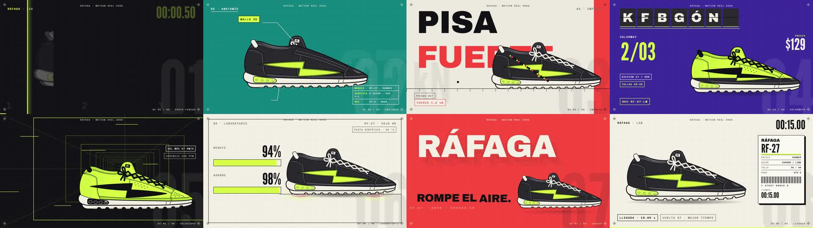

# motion-ad — anuncios animados de producto con un solo prompt

Le describes tu producto a Claude Code y te devuelve un **anuncio de motion graphics hecho 100 % con código**:
el producto dibujado por partes que se desarma, cambia de color, cae y se revela; tipografía de póster, cifras
gigantes, etiquetas técnicas, cortes al compás de la música y efectos de sonido en cada golpe. Sin After Effects.
Sin animador. Tú describes y apruebas.

Hecha por [Diego Osorio](https://instagram.com/soydiegoosorio).

  



**[👉 Guía paso a paso para instalarla y pedir tu primer anuncio](https://diegodoc1111.github.io/motion-ad/)**

## Instalar (copia y pega esto en Claude Code)

```
Instala esta skill de Claude Code: clónala desde https://github.com/diegodoc1111/motion-ad dentro de ~/.claude/skills/motion-ad y corre su instalador (scripts/instalar.py). Si falta algún programa, instálalo conmigo paso a paso.
```

Claude clona la skill y revisa que tengas Python 3.10+, Node.js 20+ y ffmpeg; deja listo HyperFrames (el motor
que renderiza) y sus skills oficiales. Después abre una conversación nueva.

¿Prefieres hacerlo a mano? Windows (PowerShell):

```powershell
git clone https://github.com/diegodoc1111/motion-ad "$HOME\.claude\skills\motion-ad"
python "$HOME\.claude\skills\motion-ad\scripts\instalar.py"
```

Mac o Linux:

```bash
git clone https://github.com/diegodoc1111/motion-ad ~/.claude/skills/motion-ad
python3 ~/.claude/skills/motion-ad/scripts/instalar.py
```

## Usarla

En una conversación nueva de Claude Code:

```
Hazme un anuncio animado de 15 segundos con motion-ad. Producto: una botella térmica de acero, marca NORTE, modelo N-500. Colores: negro mate con detalles naranja, y una variante blanca. Datos: 24 h frío, 12 h calor, 500 ml, 290 g. Lema: "FRÍO QUE DURA". Música: C:\Musica\upbeat.mp3
```

Claude hace todo esto solo:

1. **Dibuja tu producto** como vector por partes (si le das una foto, lo dibuja parecido) y te muestra capturas.
2. **Analiza la música**: detecta el tempo, recorta la pista para que un compás caiga en el segundo 0 y corta las escenas ahí.
3. **Diseña 6-9 escenas**, cada una con una técnica distinta: revelado, anatomía 3D, slam tipográfico, cambio de color, túnel de velocidad, cifra contadora, sello, lockup y cierre de catálogo.
4. **Pone 40-60 efectos de sonido** sincronizados con cada golpe.
5. **Revisa su propio trabajo** (0 errores de lint, capturas de cada escena) antes de mostrarte un **borrador**.
6. Pides cambios. Cuando apruebas, **exporta el final** a 60 cuadros por segundo.

## Qué puedes pedirle

- "Cambia el acento por el azul de mi marca."
- "Que el cierre muestre el precio y la web."
- "Hazlo vertical para publicarlo solo."
- "El dato héroe es 24 horas, no el peso."
- "Compáralo con este anuncio de referencia y dime qué le falta." (lo revisa un juez independiente)

## Qué necesitas

| | Para qué | Costo |
|---|---|---|
| Claude Code con plan de pago | quien diseña y arma el anuncio | tu plan |
| Python 3.10+, Node.js 20+, ffmpeg | el motor (HyperFrames se instala solo) | gratis |
| Una pista de música libre de derechos | el ritmo del anuncio | gratis (Pixabay Music) |

No pide llaves ni cuentas de terceros: todo se renderiza en tu computador. Probada en Windows 11; en Mac y
Linux está preparada para funcionar, pero ahí se ha probado menos (abre un *issue* si algo falla).

## Preguntas

**¿Cuánto tarda?** Un anuncio de 15 s: Claude diseña y revisa durante una hora larga; el render del borrador
tarda ~1 min y el final ~2 min. La primera vez súmale la instalación.

**¿Cuánto gasta de mi plan?** Lo que más gasta es diseñar las escenas (es código). Un anuncio completo de 15 s
con una ronda de ajustes cabe en una sesión normal de Claude Code; evita pedirle agentes en paralelo.

**¿Trae música?** No, por derechos de autor. Baja una pista libre de derechos (por ejemplo de
[Pixabay Music](https://pixabay.com/music/)) y pásale la ruta. Los efectos de sonido sí vienen incluidos.

**¿Sirve para animarme a mí hablando?** No. Para eso está [reel-motion](https://github.com/diegodoc1111/reel-motion)
(tú recortado dentro de un diseño) o [video-imperio-edit](https://github.com/diegodoc1111/video-imperio-edit)
(edición clásica de tu video). Esta es para anuncios SIN presentador.

## Qué trae

```
SKILL.md                      instrucciones para Claude (flujo, contrato del producto, catálogo de técnicas, reglas)
scripts/
  instalar.py                 revisa programas y deja listo HyperFrames + sus skills
  nuevo.py                    crea un proyecto (o copia el ejemplo completo)
  musica.py                   tempo, corte en compás, normalización, grilla de escenas
  construir.py                escenas + producto + kit de densidad → composiciones
  ensamblar.py                plan.json → index.html (slots, transiciones, música, efectos)
  verificar.py                formato, volumen y hoja de cuadros de un render
plantilla/
  proyecto/                   proyecto en blanco: 2 escenas de muestra, botella de muestra, plan y diseño
  ejemplo-rafaga/             el anuncio completo del tenis RÁFAGA RF-27 (8 escenas, 58 cues) para estudiar
  base/                       package.json, hyperframes.json, CLAUDE.md del proyecto
recursos/sfx/                 16 efectos de sonido (Pixabay) + créditos
docs/                         la guía de instalación (GitHub Pages)
```

## Créditos y licencias

- El código de esta skill, las plantillas y el dibujo del tenis RÁFAGA: **MIT** (ver [LICENSE](LICENSE)).
- Render: [HyperFrames](https://github.com/heygen-com/hyperframes) (Apache-2.0) · animación: [GSAP](https://gsap.com).
- Efectos de sonido: [Pixabay](https://pixabay.com/sound-effects/) bajo la Pixabay Content License (ver
  `recursos/sfx/CREDITS.md`); `thump.wav` sintetizado para esta skill.
- Fuentes (Archivo Black, League Gothic, Space Mono, Inter): Google Fonts, SIL Open Font License; HyperFrames
  las descarga al renderizar.
- RÁFAGA es una marca ficticia. Los logos y marcas que aparezcan en tus anuncios pertenecen a sus dueños. Esta
  skill no está afiliada a Anthropic ni a HeyGen.

## Esto es solo 1 de los agentes de Imperio

Esta skill hace tu anuncio. En **Imperio** tengo un equipo de agentes de IA que además **ejecuta** el marketing
y trae las ventas de los negocios de mis clientes: guiones, anuncios, VSL, campañas en Meta Ads, carruseles y
respuesta por WhatsApp e Instagram. Haces en 3 días lo que antes te tomaba 30; mis clientes han sumado entre
5.000 y 10.000 dólares extra cada mes a su facturación. **[Escríbeme "IMPERIO" por Instagram](https://ig.me/m/soydiegoosorio).**
